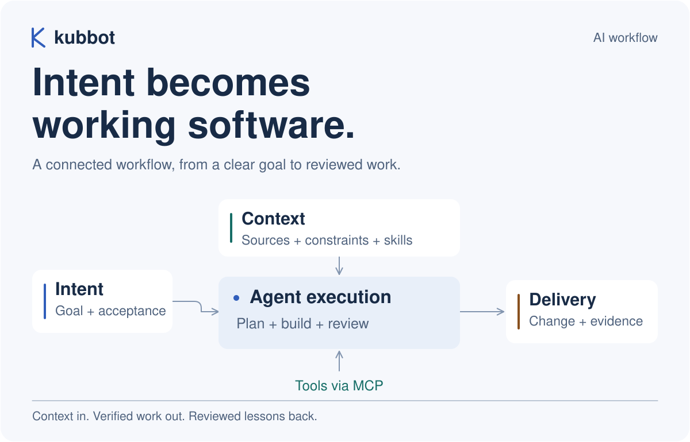
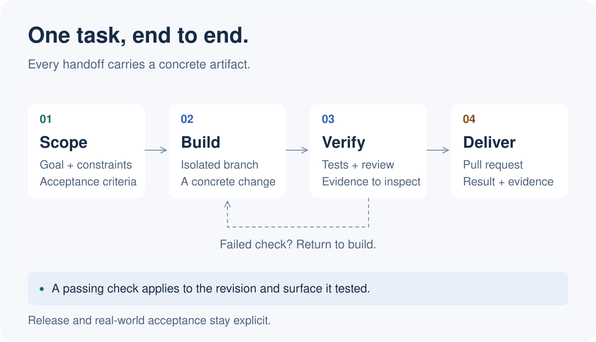
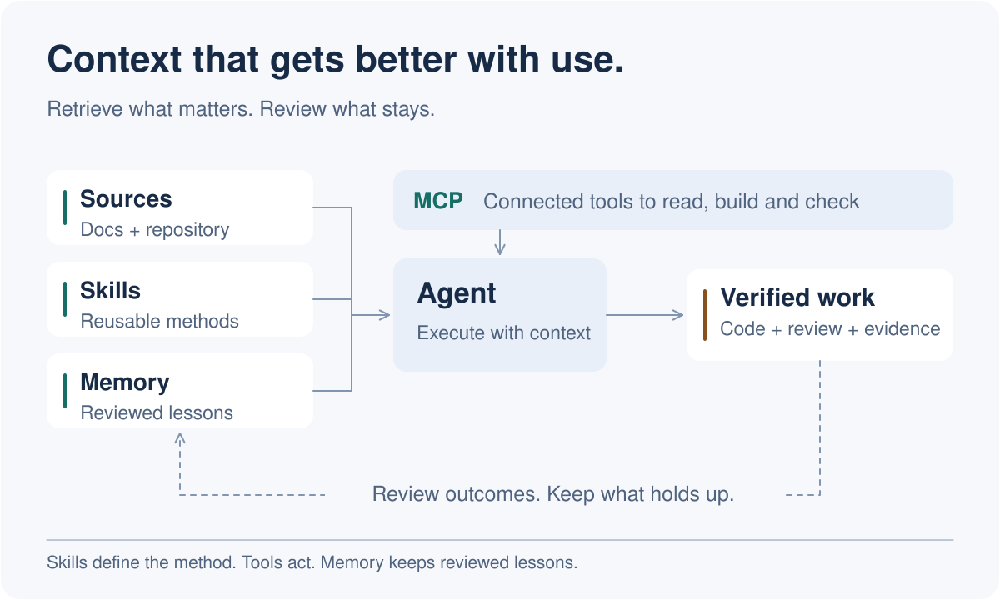

<picture>
  <source media="(max-width: 600px) and (prefers-color-scheme: dark)" srcset="assets/workflow/overview-mobile-dark.svg">
  <source media="(max-width: 600px)" srcset="assets/workflow/overview-mobile-light.svg">
  <source media="(prefers-color-scheme: dark)" srcset="assets/workflow/overview-dark.svg">
  
</picture>

把想法变成可以检查的成果。这里展示我组织 AI 开发的方式：用上下文约束任务，让 Agent 调用工具推进工作，再用测试、审查和实际验收判断结果。

[执行流程](#one-task-end-to-end) · [上下文架构](#context-that-compounds) · [搭建入口](#build-your-own)

## One task, end to end

每一步交出具体产物：验收标准、隔离分支、验证证据，最后是可审查的 PR。检查失败就回到构建；发布和真实使用验收各自保留状态。

<picture>
  <source media="(max-width: 600px) and (prefers-color-scheme: dark)" srcset="assets/workflow/execution-mobile-dark.svg">
  <source media="(max-width: 600px)" srcset="assets/workflow/execution-mobile-light.svg">
  <source media="(prefers-color-scheme: dark)" srcset="assets/workflow/execution-dark.svg">
  
</picture>

## Context that compounds

文档和仓库提供事实，Skills 说明方法，MCP 连接工具。记忆只保留经过核对的经验，下一次任务按需取用；重要取舍和高影响操作由人裁决。

<picture>
  <source media="(max-width: 600px) and (prefers-color-scheme: dark)" srcset="assets/workflow/context-mobile-dark.svg">
  <source media="(max-width: 600px)" srcset="assets/workflow/context-mobile-light.svg">
  <source media="(prefers-color-scheme: dark)" srcset="assets/workflow/context-dark.svg">
  
</picture>

## Build your own

| 组件 | 怎么接起来 |
| :--- | :--- |
| **任务入口** | 在 issue 中写清目标、约束和验收标准，再让 Agent 读取相关源码与官方文档。 |
| **可复用方法** | 从 [Agent Kit](https://github.com/cubxxw/agent-kit) 整理 Skills 和项目指令，让不同 Agent 使用一致的方法。 |
| **工具与执行** | 通过 [MCP](https://modelcontextprotocol.io/docs/getting-started/intro) 连接需要的工具，在独立分支或 worktree 中实施变更。 |
| **验证与交付** | 用 [GitHub Actions](https://docs.github.com/en/actions/get-started/understand-github-actions) 跑适用检查，把改动、证据和未验证项一起放进 PR。 |
| **经验回流** | 核对实际结果后记录教训，让后续任务少走一次弯路。 |

架构图为本仓库维护的 SVG，支持明暗主题和窄屏布局。[查看图源与生成方式](assets/ASSETS.md)。
